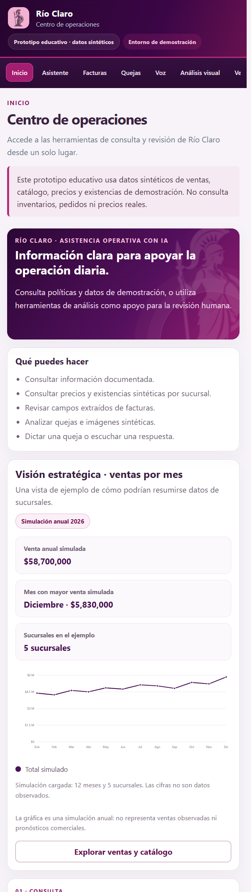
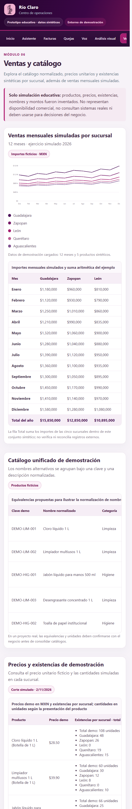
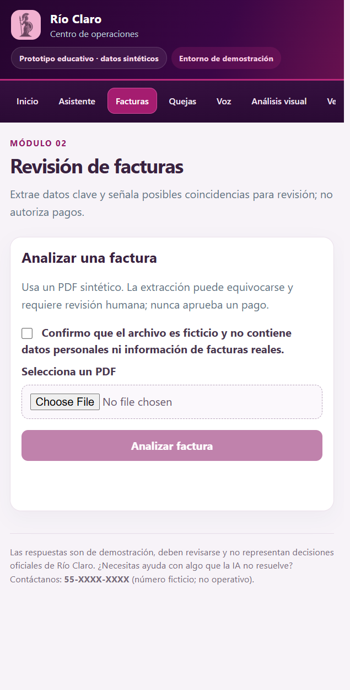
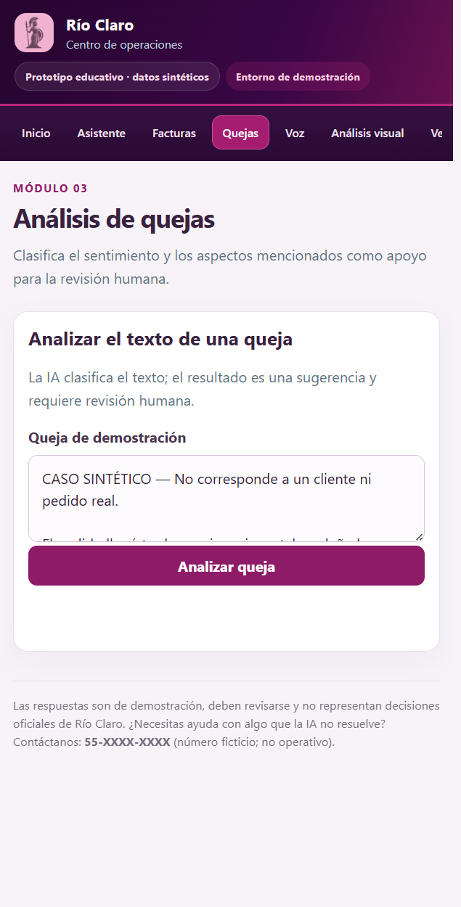
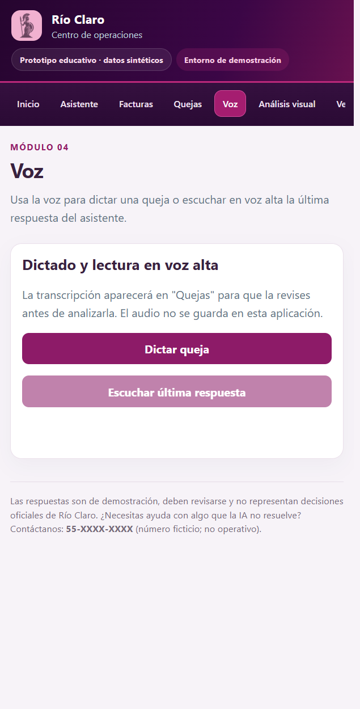
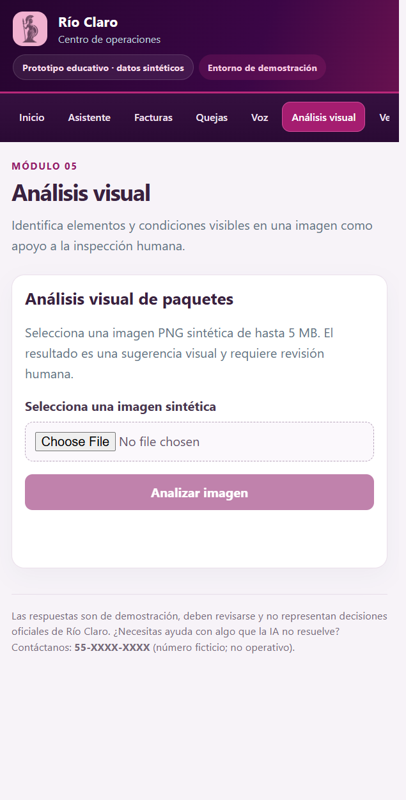
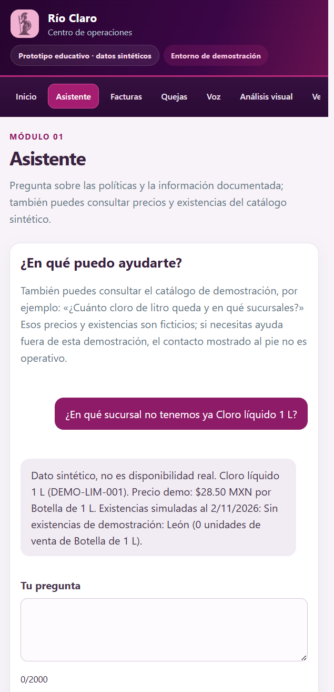
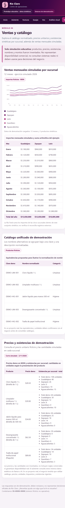

# Río Claro — de datos dispersos a un prototipo de IA útil

**Proyecto integrador AI-901 · Microsoft Azure AI Fundamentals**  
**Fecha de preparación:** 2 de noviembre de 2026  
**Aplicación publicada:** [Centro de operaciones Río Claro](https://rio-claro-demo-261031-ezhkfqdvfrdyb2dp.westus3-01.azurewebsites.net/)

**Base de requisitos:** *Proyecto_AI-901_Rio_Claro Final.pdf*, secciones 2 a 6.

> **Importante:** todos los documentos, productos, precios, existencias, ventas, facturas, quejas e imágenes del prototipo son sintéticos. El ejemplo de inventario se lee de un archivo estático y no se conecta a existencias, pedidos, ventas, clientes ni sistemas reales de Distribuidora Río Claro. Las respuestas de IA son sugerencias que requieren revisión humana.

## 1. Problema del caso

Distribuidora Río Claro es una empresa ficticia con varias sucursales y fuentes de información separadas. El enunciado del proyecto describe, entre otros, estos problemas:

- Las facturas de proveedores llegan en distintos formatos y ubicaciones; su captura manual consume tiempo y puede ocasionar errores o pagos duplicados.
- Los datos de productos no están normalizados entre sucursales, lo que dificulta consultar información coherente.
- Las quejas y dudas de clientes se reciben por canales diferentes y no forman un historial centralizado.
- Las políticas internas tienen varias versiones.
- El personal necesita una solución sencilla que pueda utilizar desde el navegador y, en ciertos casos, por voz.
- Se requiere que las personas sepan cuándo interactúan con IA y revisen las sugerencias antes de tomar decisiones.

El objetivo de este prototipo es demostrar cómo algunas capacidades de Microsoft Azure AI podrían ayudar con esas tareas y, a la vez, distinguir claramente lo que el piloto **no** resuelve todavía.

## 2. Cómo entrar

1. Abrir la [aplicación publicada](https://rio-claro-demo-261031-ezhkfqdvfrdyb2dp.westus3-01.azurewebsites.net/).
2. Iniciar sesión con una cuenta de Microsoft Entra del tenant donde se configuró la aplicación.
3. Elegir un módulo desde el menú lateral o desde las tarjetas de Inicio.

La autenticación está activada. El acceso no está limitado a una lista de usuarios o a un rol de la aplicación: puede entrar una identidad autenticable del mismo tenant. El propietario acepta este alcance para la demostración. Si el docente pertenece a otro tenant, deberá tener acceso mediante el proceso institucional correspondiente antes de que pueda iniciar sesión.

La página de Inicio, el catálogo sintético, la gráfica y las consultas de precio/existencia del catálogo no realizan consultas a modelos de IA. Las preguntas documentales del Asistente y los módulos Facturas, Quejas, Voz o Análisis visual sí pueden consumir cuota o generar cargos de los servicios correspondientes.

## 3. Solución construida

El sitio reúne en una sola aplicación web estos flujos:

| Módulo | Qué demuestra | Límite actual |
|---|---|---|
| **Asistente** | Conversación con un agente de Microsoft Foundry para fuentes documentales; responde consultas reconocidas sobre productos, precio demo y existencias por sucursal con una búsqueda determinista en el catálogo sintético. | El catálogo no contiene datos reales ni se envía al agente para responder; una consulta reconocida no llama a IA. No consulta pedidos, inventario ni precios reales. |
| **Facturas** | Carga de un PDF, extracción de proveedor, folio, fecha y total con confianza, y alerta de coincidencia por proveedor y folio en un registro sintético. | No se conecta al correo, WhatsApp, Excel ni a un sistema contable. La alerta no bloquea pagos y toda extracción requiere revisión humana. |
| **Quejas** | Análisis de sentimiento y aspectos mencionados, con evidencia textual. | No almacena ni enlaza casos repetidos y no responde al cliente ni registra acciones de seguimiento. |
| **Voz** | Dictado en español que pasa el texto a Quejas y lectura en voz alta de una respuesta disponible del asistente. | No consulta el inventario por voz ni guarda audio. El uso del micrófono depende de los permisos del navegador y del equipo. |
| **Análisis visual** | Análisis de una imagen PNG para describir paquetes y condiciones visibles. | No confirma el contenido de una caja, no determina responsabilidades y requiere inspección humana. |
| **Ventas y catálogo** | Catálogo de demostración con nombres alternativos normalizados, precios unitarios ficticios, existencias inventadas por sucursal y comparación aritmética de ventas mensuales entre cinco sucursales. | No concilia libros, archivos ni sistemas externos; precios y existencias no representan disponibilidad comercial ni deben sustentar decisiones del negocio. |

### Ejemplo de catálogo y ventas

El catálogo agrupa alias inventados, como «Cloro 1L» y «CLORO LITRO», bajo una clave y descripción de demostración. El mismo archivo estático `public/data/ventas-catalogo-demo.json` contiene el precio ficticio por presentación y las unidades sintéticas por sucursal; no se usa una base de datos. Para el cloro líquido de 1 L el ejemplo muestra **$28.50 MXN** y **108 unidades** en total: Guadalajara 48, Zapopan 26, León 0, Querétaro 19 y Aguascalientes 15.

El corte de inventario del ejemplo es el **2 de noviembre de 2026**. Las cantidades se expresan como unidades de venta según la presentación (por ejemplo, botellas o paquetes). El precio ilustrativo es común para el producto en este escenario, no es una cotización, no considera reglas comerciales ni garantiza existencia real. El asistente puede responder consultas reconocidas sobre estos datos estáticos; si no identifica el producto, indica la limitación en vez de pedir a IA que invente una respuesta. No se implementó consulta por voz de existencias.

El escenario contiene cinco sucursales y doce meses simulados de 2026, con una suma aritmética de **$58,700,000 MXN ficticios**. También se incluyen meses posteriores a la fecha de preparación: esos valores igualmente son inventados; no son resultados observados ni pronósticos. La consistencia de las sumas solo se refiere a este conjunto de ejemplo, no a una conciliación empresarial.

## 4. Relación con las necesidades del enunciado

| Necesidad o criterio del curso | Función demostrable | Estado / limitación explícita |
|---|---|---|
| IA generativa y agentes | El asistente y los flujos especializados de análisis usan agentes de Foundry. | Se trabaja con las fuentes y datos sintéticos preparados para la demostración. |
| Reducir la captura manual de facturas | Extracción de campos, nivel de confianza y revisión de posibles duplicados. | El prototipo no automatiza la recepción ni la contabilización; no se ha medido una reducción de horas. |
| Prevenir pagos duplicados | Coincidencia de proveedor y folio contra un registro de prueba. | Es una advertencia, no una garantía de «cero pagos duplicados» ni una autorización o bloqueo de pago. |
| Responder dudas de clientes y empleados | Interfaz de conversación basada en material documental de demostración. | No tiene conexión a los canales de atención ni contexto de pedidos; no se mide el tiempo de respuesta del negocio. |
| Analizar quejas y temas recurrentes | Clasificación de sentimiento y aspectos con evidencia. | No centraliza quejas ni calcula tendencias históricas. |
| Consultar precios y existencias por producto/sucursal | Tabla operativa y consulta en el Asistente con el mismo conjunto estático de precios y unidades sintéticas por sucursal. | El ejemplo no se conecta a inventarios reales, no confirma disponibilidad comercial y requiere que negocio valide precios, impuestos y presentaciones. |
| Ordenar el catálogo y comparar sucursales | Alias de productos normalizados y tabla/gráfica mensual con sumas sintéticas. | No armoniza los libros de trabajo reales ni valida ventas reales de las sucursales. |
| Incluir al personal que prefiere voz o celular | Diseño adaptable a móvil, reconocimiento de voz y lectura en voz alta. | Dictado de quejas y lectura de respuestas no equivalen a consulta oral de existencias reales. |
| Demostrar visión y extracción de información | Análisis visual de PNG y extracción de campos de PDF. | Los resultados son probabilísticos y deben verificarse. |
| Transparencia y rendición de cuentas | Avisos visibles sobre IA y datos sintéticos; revisión humana obligatoria en resultados sensibles. | El prototipo no sustituye políticas de aprobación ni controles de negocio. |
| Privacidad y acceso | Inicio de sesión con Microsoft Entra; identidad administrada para acceso de la aplicación a Foundry. | El acceso se comparte con identidades del tenant y no se discrimina por usuario, sucursal o rol. No hay integración con Key Vault ni con datos empresariales reales. |

## 5. Componentes técnicos

- **Azure App Service (Linux, Node.js):** publica la aplicación y su servidor Express.
- **Microsoft Entra ID / App Service Authentication:** exige inicio de sesión.
- **Microsoft Foundry:** aloja los agentes del asistente, análisis de quejas y análisis visual; la identidad administrada de la Web App accede a los agentes configurados.
- **Azure AI Search:** proporciona recuperación sobre las fuentes documentales usadas por el asistente.
- **Azure AI Document Intelligence:** analiza facturas PDF de demostración.
- **Azure Speech:** habilita dictado y síntesis de voz.
- **Interfaz web:** HTML, CSS y JavaScript, con gráficas SVG sin bibliotecas externas. La consulta de precios/existencias utiliza una búsqueda determinista en los datos sintéticos cargados en el navegador; no se envía al agente ni consume una llamada de modelo.

El servidor no almacena los PDF o PNG recibidos como parte de estos flujos. Los archivos de ventas, catálogo, precios y existencias son estáticos y sintéticos; no hay una base de datos de sucursales conectada.

La aplicación requiere servicios de Azure para las funciones de IA. El plan App Service B1 existente mostró una estimación de **12.41 USD/mes** al configurarse; el costo real depende del uso y de los cargos vigentes. No se agregó ningún servicio de Azure para el inventario sintético. Las consultas de precios/existencias no consumen cuota de IA; los demás módulos de IA sí pueden hacerlo.

## 6. IA responsable, seguridad y privacidad

- La interfaz avisa que el usuario interactúa con IA y que las cifras y documentos de ejemplo son sintéticos.
- El sistema exige revisión humana en la lectura de facturas, la alerta de posibles duplicados, el análisis de quejas y la descripción visual.
- El análisis visual describe solo lo visible; no debe inferir el contenido de las cajas ni asignar responsabilidades.
- No se deben cargar facturas reales, datos personales, información de clientes, precios internos ni otra información sensible.
- La autenticación de Entra protege el acceso inicial, pero **no** implementa autorización por rol, usuario o sucursal. Cualquier identidad habilitada del tenant podría entrar.
- El teléfono de contacto mostrado, `55-XXXX-XXXX`, es un marcador ficticio y no operativo; no es un canal de soporte.
- No se afirma que haya Key Vault ni una conexión a los permisos, archivos o datos reales descritos en el caso.

## 7. Validación y evidencia

### Capturas de la aplicación publicada

Estas capturas corresponden a la aplicación publicada y muestran la interfaz y la navegación. La captura del Asistente contiene una consulta demostrativa de catálogo resuelta desde el archivo sintético, no por el agente. No se enviaron mensajes, archivos, audio ni imágenes a servicios de IA durante la toma de capturas.

El documento de entrega es Markdown. Mantén la carpeta `evidencias` junto a este archivo al abrirlo o entregarlo para que se resuelvan las imágenes enlazadas.

#### Inicio y resumen simulado

#### Ventas y catálogo sintéticos

#### Revisión de facturas

#### Análisis de quejas

#### Voz

#### Análisis visual

#### Consulta de existencias desde el Asistente

#### Precios y existencias por sucursal

### Pruebas funcionales sintéticas realizadas durante el desarrollo

Antes de publicar se probaron localmente los flujos con material sintético:

- **Facturas:** extracción de proveedor, folio, fecha y total; presentación de confianza y coincidencia con el registro ficticio.
- **Quejas:** el caso de demostración se clasificó como negativo e identificó entrega tardía y mercancía dañada con evidencia textual.
- **Voz:** el dictado pasó texto al campo de quejas y la lectura en voz alta reprodujo una respuesta del asistente.
- **Visión:** una imagen sintética produjo tres cajas descritas; la caja central se identificó con daños visibles y el resultado indicó revisión humana.
- **Asistente:** se comprobó conversación con las fuentes de demostración configuradas.
- **Despliegue:** se confirmó la publicación del paquete en App Service, el estado `Running`, la redirección al inicio de sesión de Entra y, después de iniciar sesión, la carga del Centro de operaciones.
- **Consulta operativa publicada:** «¿Cuánto cloro de litro nos queda?» mostró el precio demo de $28.50 MXN y 108 unidades sintéticas distribuidas entre las cinco sucursales; el seguimiento «¿Y en Zapopan?» respondió 26. Se verificó que ambas consultas no llamaron al endpoint `/api/chat` ni al agente de IA.
- **Consulta de falta de existencias:** «¿En qué sucursal no tenemos ya Cloro líquido 1 L?» identificó León con 0 unidades sintéticas. La respuesta se limita a las sucursales sin existencias y no llamó al endpoint `/api/chat` ni al agente de IA.

No se invocaron los módulos de IA durante la publicación, la navegación de capturas ni la preparación de este documento. La respuesta ilustrada en la captura 07 se obtuvo del catálogo estático sintético, sin consumo de IA.

## 8. Resultado y siguientes pasos posibles

El prototipo ofrece una liga accesible, una interfaz navegable y demostraciones de conversación, extracción documental, análisis de texto, voz, visión y resumen de datos sintéticos. Cubre varias capacidades y problemas planteados por el curso, pero **no equivale a una solución operativa conectada a Río Claro**.

Para evolucionarlo fuera de este piloto se necesitarían, como mínimo, fuentes oficiales y responsables de datos, reglas de acceso por persona/sucursal, validación de catálogo y ventas con el negocio, seguimiento de quejas, integración con los sistemas de pedidos/inventario y evaluación de costos, privacidad y calidad antes de usar información real.
